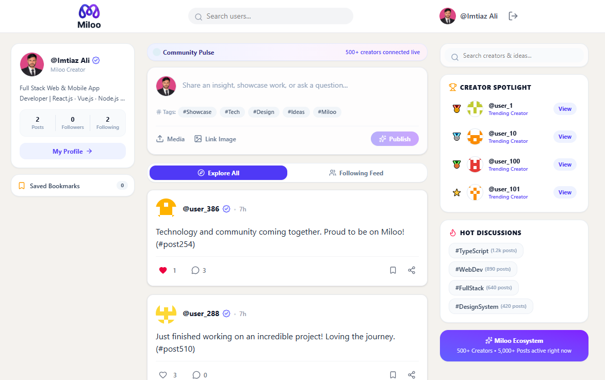

<p align="center">
  
</p>

<h1 align="center">Miloo — Social Media Platform</h1>

<p align="center">
  A modern, high-performance social networking web application designed for community engagement, creator spotlighting, and seamless content sharing.
</p>

<p align="center">
  
  
</p>

<p align="center">
  
  
  
  
  
  
  
</p>

> [!NOTE]
> ### 🏆 CodeAlpha Internship Showcase — Project 3
> This project was developed as **Project 3: Full-Stack Social Networking Application** for the **Full Stack Development Internship** program at **CodeAlpha**. It demonstrates end-to-end software development capabilities including scalable backend architecture, database modeling, secure JWT authentication, and an intuitive user interface.

---

## 📸 Preview

<p align="center">
  
</p>

---

## ✨ Features

- **Personalized Feed & Explore Stream**: Switch seamlessly between global trending posts and a curated feed of creators you follow.
- **Rich Post Composer**: Create text and media posts with instant file upload or photo URL, hashtag chips (`#Showcase`, `#Tech`, etc.), and real-time feed updates.
- **Infinite Scrolling Feed**: High-performance content streaming powered by modern `IntersectionObserver` API — no manual page navigation required.
- **Expandable Long Posts**: Clean feed hygiene with automatic character truncation (`...more` / `less` toggle).
- **Interactive Engagements**: Like posts with live counter updates, full comment thread CRUD, and interactive modal dialogs.
- **Live Local Bookmarks**: One-click bookmarking synchronized across post cards and profile widgets via custom browser events.
- **Real-Time Live Search**: Debounced search as you type, recent search history with quick clearing, and infinite scroll for discovered users.
- **Creator Profiles**: Comprehensive profiles featuring user statistics, banner branding, avatar uploads, and dedicated Followers/Following modal lists.
- **Creator Spotlight & Trends**: Sidebar highlights top community leaders, platform analytics, and trending discussion topics.
- **Robust Security**: JSON Web Token (JWT) cookie/header authentication, bcrypt password hashing, and Yup input schema validation.

---

## 🛠️ Tech Stack

### Frontend
- **Framework**: React 19 + TypeScript
- **Styling**: Tailwind CSS v4 + Lucide React Icons
- **Bundler**: Vite
- **Routing**: React Router v7
- **HTTP Client**: Axios with automatic JWT interceptors

### Backend
- **Runtime**: Node.js + Express 5
- **Language**: TypeScript (`tsx` runtime execution)
- **Database & ORM**: MySQL + Sequelize ORM
- **Authentication**: JWT (JSON Web Tokens) + `bcryptjs`
- **Validation**: Yup Schema Validation

---

## 📁 Project Architecture

```text
CodeAlpha_Miloo/
├── client/                     # Frontend Application
│   ├── public/                 # Static assets (favicons, brand logo, preview)
│   ├── src/
│   │   ├── components/         # Reusable UI widgets (Navbar, PostCard, CreatePost, etc.)
│   │   ├── context/            # AuthContext (state, tokens, session)
│   │   ├── pages/              # Feed, Profile, Search, Login, Register
│   │   ├── routes/             # AppRoutes & ProtectedRoute guards
│   │   ├── services/           # Axios client instance with interceptors
│   │   └── types/              # Centralized TypeScript definitions
│   └── package.json
│
├── server/                     # Backend Application
│   ├── src/
│   │   ├── config/             # Database connection & Sequelize instance
│   │   ├── controllers/        # Route controllers (auth, post, user, comment, follow)
│   │   ├── middlewares/        # Auth, error, and validation middlewares
│   │   ├── models/             # Sequelize data models & relationship associations
│   │   ├── routes/             # Express API endpoints
│   │   ├── services/           # Business logic layer
│   │   ├── validations/        # Yup request validation schemas
│   │   └── seed.ts             # Demo data population script
│   └── package.json
└── README.md
```

---

## 🚀 Getting Started

### Prerequisites
- [Node.js](https://nodejs.org/) (v18.x or later)
- [MySQL Server](https://dev.mysql.com/downloads/mysql/) running locally or remotely

---

### 1. Backend Setup

```bash
cd server
npm install
```

Create a `.env` file in the `server/` directory:

```env
PORT=5000
NODE_ENV=development

# MySQL Database Configuration
DB_HOST=localhost
DB_PORT=3306
DB_NAME=miloo_db
DB_USER=root
DB_PASSWORD=your_password

# Authentication
JWT_SECRET=your_super_secret_jwt_key
JWT_EXPIRES_IN=7d
BCRYPT_SALT_ROUNDS=10
```

Run database migrations and start the dev server:

```bash
# Seed initial demo data (Optional: 500 users, posts, comments)
npx tsx src/seed.ts

# Start backend server
npm run dev
```

---

### 2. Frontend Setup

```bash
cd ../client
npm install
npm run dev
```

The application will be running at `http://localhost:5173`.

---

## 📡 API Endpoints Overview

| Method | Endpoint | Description | Auth Required |
|:---:|---|---|:---:|
| `POST` | `/api/auth/register` | Register new account | ❌ |
| `POST` | `/api/auth/login` | Login and obtain JWT token | ❌ |
| `GET` | `/api/posts` | Paginated global explore feed | ✅ |
| `GET` | `/api/posts/feed` | Personalized following feed | ✅ |
| `POST` | `/api/posts` | Create new post | ✅ |
| `PATCH` | `/api/posts/:id` | Edit own post | ✅ |
| `DELETE` | `/api/posts/:id` | Delete own post | ✅ |
| `POST` | `/api/likes/:postId` | Toggle post like | ✅ |
| `GET` | `/api/comments/:postId` | Retrieve post comments | ✅ |
| `POST` | `/api/comments/:postId` | Add comment to post | ✅ |
| `GET` | `/api/users/search?username=` | Search users (paginated) | ✅ |
| `GET` | `/api/users/:id` | Get user profile & posts | ✅ |
| `PATCH` | `/api/users/me` | Update bio, username, avatar | ✅ |
| `POST` | `/api/follows/:userId` | Follow a user | ✅ |
| `DELETE` | `/api/follows/:userId` | Unfollow a user | ✅ |

---

## 🎖️ Internship Submission Details

- **Company / Organization:** [CodeAlpha](https://www.codealpha.tech/)
- **Domain:** Full Stack Web Development
- **Task:** Project 3 — Social Media Web Application
- **Developer:** Full Stack Development Intern
- **Key Objectives Accomplished:**
  - Designed fully normalized relational database schema with Sequelize ORM.
  - Implemented 15+ secure RESTful API endpoints with authentication guards.
  - Created a responsive, modern web UI using React 19, TypeScript, and Tailwind CSS v4.
  - Delivered production-ready code with seeders, error-handling middleware, and infinite pagination.

---

## 🛡️ License

This project is licensed under the [ISC License](LICENSE).
